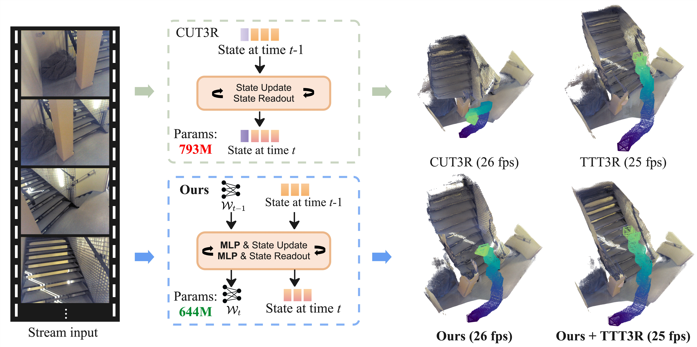

<div align="center">
<h1>Mem3R: Streaming 3D Reconstruction with Hybrid Memory</h1>

<h2>WACV 2027</h2>

<a href="https://lck666666.github.io/Mem3R/Mem3R_WACV_2027.pdf"></a>
<a href="https://arxiv.org/abs/2604.07279"></a>
<a href="https://lck666666.github.io/Mem3R/"></a>

<a href="https://lck666666.github.io/">Changkun Liu</a><sup>1,2,&#42;</sup>, <a href="https://stephenjyang.com/">Jiezhi Yang</a><sup>1,&#42;</sup>, <a href="https://sites.google.com/usc.edu/zemanli/">Zeman Li</a><sup>1</sup>, <a href="https://sites.google.com/view/yuandeng/home">Yuan Deng</a><sup>1</sup>, Jiancong Guo<sup>1</sup>, <a href="https://binbin-xu.github.io/">Binbin Xu</a><sup>1</sup>, <a href="https://lucaballan.altervista.org/">Luca Ballan</a><sup>1</sup>

<sup>1</sup>Google &nbsp; <sup>2</sup>The Hong Kong University of Science and Technology

<sup>&#42;</sup>Equal contribution.
</div>

<p align="center">
  <a href="https://lck666666.github.io/Mem3R/">
    
  </a>
</p>

## Updates

- **2026-10**: Mem3R accepted to WACV 2027. Released the reimplementation code.

## Clarification

**This is a reimplementation of Mem3R.** We aim to keep this implementation
consistent with the original official experimental results, but the reimplementation
has not yet undergone full experimental validation.

---

## 📜 Citation

If you find Mem3R useful in your research, please cite:

```bibtex
@inproceedings{liu2027mem3r,
  title={Mem3R: Streaming 3D Reconstruction with Hybrid Memory},
  author={Liu, Changkun and Yang, Jiezhi and Li, Zeman and Deng, Yuan and Guo, Jiancong and Xu, Binbin and Ballan, Luca},
  booktitle={Proceedings of the IEEE/CVF Winter Conference on Applications of Computer Vision (WACV)},
  year={2027}
}
```

---

## Implementation layout

The backbone remains in `src/dust3r/model.py`. Hybrid memory components are
organized in `src/dust3r/memory/`: `fast_weights.py` implements pose-memory
read/write operations, `state_gates.py` implements geometric-state gates,
`token_memory.py` retains the CUT3R baseline, and `numerics.py` contains shared
numerical primitives. Existing parameter names, packed weight ordering, model
configuration fields, and command-line flags are retained for compatibility.

## 💡 Architecture and Model Variants

**Mem3R** combines two memory mechanisms:

1. **Channel-Wise State Gating (`ChannelWiseStateGate`)**:
   - Computes an element-wise modulation gate `[B, N_state, C]` between new frame visual summary features and historical 3D state tokens, allowing fine-grained updates of spatial features while preserving long-term semantic memory across channels.

2. **Test-Time Training Memory (`TTTMemory`)**:
   - `TTTMemory` serves as the pose retriever when configured with `--pose_memory ttt`.
   - Uses an online-updated SwiGLU MLP to store pose information in fast weights. The `ttt` option selects this fast-weight memory module.

### Memory settings

Three independent options control different parts of the model:

| Option | Default | Meaning |
|---|---|---|
| `--pose_memory` | `ttt` | Pose tracking: `ttt` fast weights or `local` Transformer token memory |
| `--state_gate` | `channel` | Learned channel-wise geometry gate: `channel` or `none` |
| `--state_update` | `direct` | Geometry update rule: `direct`, `ttt3r`, or `ttsa3r` |

`ttt` selects pose memory; it does not enable TTT3R. `direct` means no additional
training-free update rule; the learned channel gate still applies when enabled.
When both a channel gate and a TTT3R/TTSA3R rule are enabled, their gates multiply.

| Paper variant | Pose memory | State gate | State update |
|---|---|---|---|
| **Mem3R** | `ttt` | `channel` | `direct` |
| **Mem3R + TTT3R** | `ttt` | `channel` | `ttt3r` |
| **Mem3R + TTSA3R** | `ttt` | `channel` | `ttsa3r` |

Run the three variants on the same image folder or video. Each command explicitly
sets the pose memory, channel gate, and state-update rule:

```bash
WEIGHTS=checkpoints/default_64_views.pth
INPUT=path/to/image_folder_or_video

# Mem3R: enable TTT fast-weight pose memory and the learned channel-wise
# geometry gate; use direct state updates without TTT3R or TTSA3R.
python demo.py --model_path "$WEIGHTS" --seq_path "$INPUT" \
  --pose_memory ttt --state_gate channel --state_update direct \
  --output_dir output_results/mem3r

# Mem3R + TTT3R: retain TTT pose memory and the channel gate;
# additionally apply the TTT3R per-token geometry-update gate.
python demo.py --model_path "$WEIGHTS" --seq_path "$INPUT" \
  --pose_memory ttt --state_gate channel --state_update ttt3r \
  --output_dir output_results/mem3r_ttt3r

# Mem3R + TTSA3R: retain TTT pose memory and the channel gate;
# additionally apply the TTSA3R temporal-spatial geometry-update gate.
python demo.py --model_path "$WEIGHTS" --seq_path "$INPUT" \
  --pose_memory ttt --state_gate channel --state_update ttsa3r \
  --output_dir output_results/mem3r_ttsa3r
```

Add `--no_viewer` to save outputs and exit without opening the interactive
point-cloud viewer.

All three paper variants use the same Mem3R checkpoint. Switching pose memory to
`local` requires a matching CUT3R/baseline checkpoint. Disabling the gate at
inference does not reproduce an independently retrained ablation model.

The demo and evaluation launchers share these defaults. Older checkpoint option
names are translated internally during loading. The pose and video-depth examples
use `inference_recurrent_lighter()`. For custom integrations use this API or
regular `forward()`; legacy `forward_recurrent()` and `inference_step()` paths
do not apply these configurable gates.

---

## 🛠️ Installation

Use Python 3.11 and a separate environment. The dependency versions are
specified in `requirements.txt`:

```bash
cd Mem3R
python3.11 -m venv .venv
source .venv/bin/activate
python -m pip install --upgrade pip setuptools

# CUDA 13.0 wheels; use the /whl/cpu index for CPU inference.
pip install torch==2.14.1 torchvision==0.29.1 --index-url https://download.pytorch.org/whl/cu130
pip install -r requirements.txt
pip check
```

Run commands from the repository root. The bundled PyTorch RoPE implementation
works without compiling an extension, including signed pose-token coordinates.
An optional faster CUDA extension can be built with a compatible CUDA toolkit:

```bash
(cd src/croco/models/curope && python setup.py build_ext --inplace)
```

For CPU inference, use `--device cpu`. Match `CUDA_VISIBLE_DEVICES` and
`--num_processes` to your available GPUs when using the evaluation launchers.

---

## 📦 Checkpoints

Download the official **Mem3R** checkpoints below and place them in
`checkpoints/`. Only load trusted `.pth` files: their format includes Python
configuration objects.

| Checkpoint | Training Setup | Hugging Face Link | Description |
|---|---|---|---|
| **Default Checkpoint** | 64 views | [Hugging Face (64-view)](https://huggingface.co/stephenjyang/mem3r/blob/main/default_64_views.pth) | Standard setup trained on 64 views for fair comparison with CUT3R |
| **96-View Checkpoint** | 96 views | [Hugging Face (96-view)](https://huggingface.co/stephenjyang/mem3r/blob/main/mem3r_96_views.pth) | Trained on 96 views for higher performance and better reconstruction results |

```bash
mkdir -p checkpoints
curl -L --fail https://huggingface.co/stephenjyang/mem3r/resolve/main/default_64_views.pth \
  -o checkpoints/default_64_views.pth

# Optional: download the 96-view checkpoint
curl -L --fail https://huggingface.co/stephenjyang/mem3r/resolve/main/mem3r_96_views.pth \
  -o checkpoints/mem3r_96_views.pth
```

Expected directory layout:

```text
mem3r/
└── checkpoints/
    ├── default_64_views.pth
    └── mem3r_96_views.pth
```

---

## 📁 Repository Structure

```text
mem3r/
├── src/                          # Model & Persistent State Architecture
│   ├── dust3r/
│   │   ├── model.py              # Recurrent reconstruction backbone
│   │   ├── memory/               # Fast-weight pose memory and geometry gates
│   │   ├── inference.py          # Sequence inference routines
│   │   ├── blocks.py             # Attention & State Projection blocks
│   │   ├── heads/                # Depth, Pose, and 3D Regression heads
│   │   └── utils/                # Geometry, Camera, Render, Image utils
│   └── croco/                    # Backbone & RoPE positional embeddings
├── eval/                         # Evaluation Suites
│   ├── relpose/                  # Camera pose evaluation (TUM, ScanNet, Sintel)
│   ├── video_depth/              # Video depth evaluation (KITTI, Bonn, Sintel)
│   └── mv_recon/                 # 3D multi-view reconstruction evaluation
└── demo.py                       # Standalone inference demo
```

---

## 📊 Dataset Preparation

For dataset downloading and preprocessing (ScanNet, TUM Dynamics, Bonn, KITTI, Sintel, etc.), please refer to the data preparation instructions in the original **[CUT3R](https://github.com/CUT3R/CUT3R)** repository.

The long-sequence variants require prepared frame folders and synchronized ground-truth files. See [the evaluation guide](eval/eval.md) for the expected layouts.

Select reconstruction datasets with `--datasets 7scenes` or `--datasets NRGBD` and set `--seven_scenes_root` or `--nrgbd_root`. Only selected datasets are initialized. Pose and video-depth inference accept `--img_root` to override their metadata root. Bonn depth scoring accepts `--gt_root` and `--seq_list`.

---

## 🚀 Running Benchmark Evaluations

### 1. Relative Camera Pose Estimation (Long Sequences)
Evaluates camera trajectory accuracy (ATE/RPE) on long video sequences (e.g. TUM, ScanNet, Sintel).

**Ours** on 1,000-frame TUM Dynamics sequences:

```bash
CUDA_VISIBLE_DEVICES=0 accelerate launch --num_processes 1 eval/relpose/launch.py \
  --weights checkpoints/default_64_views.pth \
  --output_dir eval_results/relpose/tum_s1_1000/ours \
  --eval_dataset tum_s1_1000 \
  --size 512 \
  --state_gate channel --state_update direct \
  --pose_memory ttt
```

**Ours + TTT3R**, using the same checkpoint:

```bash
CUDA_VISIBLE_DEVICES=0 accelerate launch --num_processes 1 eval/relpose/launch.py \
  --weights checkpoints/default_64_views.pth \
  --output_dir eval_results/relpose/tum_s1_1000/ours_ttt3r \
  --eval_dataset tum_s1_1000 \
  --size 512 \
  --state_gate channel --state_update ttt3r \
  --pose_memory ttt
```

For ScanNet, replace `tum_s1_1000` with `scannet_s3_1000` in both `--eval_dataset` and `--output_dir`. For **Ours + TTSA3R**, use `--state_gate channel --state_update ttsa3r` and a separate output directory such as `eval_results/relpose/tum_s1_1000/ours_ttsa3r`.

### 2. Video Depth Estimation
Evaluates per-frame depth prediction accuracy on KITTI, Bonn, and Sintel sequences.

First run inference. This example evaluates **Ours + TTT3R** on 500-frame KITTI sequences:

```bash
CUDA_VISIBLE_DEVICES=0 accelerate launch --num_processes 1 eval/video_depth/launch.py \
  --weights checkpoints/default_64_views.pth \
  --output_dir eval_results/video_depth/kitti_s1_500/ours_ttt3r \
  --eval_dataset kitti_s1_500 \
  --size 512 \
  --state_gate channel --state_update ttt3r \
  --pose_memory ttt
```

Then compute the depth metrics from the saved predictions:

```bash
CUDA_VISIBLE_DEVICES=0 python eval/video_depth/eval_depth.py \
  --pred_dir eval_results/video_depth/kitti_s1_500/ours_ttt3r \
  --output_dir eval_results/video_depth/kitti_s1_500/ours_ttt3r \
  --eval_dataset kitti_s1_500 \
  --align scale
```

`--align scale` reports scale-invariant depth metrics. Use `--align metric` for metric-scale depth, or `--align 'scale&shift'` for scale-and-shift alignment. Quote `scale&shift` in shell commands. `eval_depth.py` scores existing predictions; it does not load a model checkpoint.

For **Ours**, change the inference flag to `--state_gate channel --state_update direct` and use matching `ours` output/prediction directories in both commands. For Bonn, replace `kitti_s1_500` with `bonn_s1_500` in the dataset argument and directory names. Keep results for different strategies in separate directories.

### 3. 3D Multi-View Reconstruction
Evaluates multi-view 3D point cloud reconstruction completeness and precision.

After configuring the dataset roots described above, run **Ours + TTT3R**:

```bash
CUDA_VISIBLE_DEVICES=0 accelerate launch --num_processes 1 eval/mv_recon/launch.py \
  --weights checkpoints/default_64_views.pth \
  --output_dir eval_results/mv_recon/ours_ttt3r_200 \
  --model_name ours_ttt3r \
  --state_gate channel --state_update ttt3r \
  --pose_memory ttt \
  --size 512 \
  --max_frames 200 \
  --datasets 7scenes \
  --seven_scenes_root data/7scenes
```

For **Ours**, use `--state_gate channel --state_update direct` and update `--model_name`/`--output_dir` accordingly. `--model_name` labels the run; `--state_gate` and `--state_update` select the actual update behavior.

The `eval/*/run*.sh` scripts default to `checkpoints/default_64_views.pth`, `POSE_MEMORY=ttt`, `STATE_GATE=channel`, `STATE_UPDATE=direct`, and one process. Override these variables, `MODEL_WEIGHTS`, or `NUM_PROCESSES` as needed. The explicit commands above make each run configuration visible.

---

## 💻 Running Custom Sequence Inference / Demo

To run Mem3R inference on a custom sequence of image frames and save predicted depth maps, confidence, RGB images, and camera parameters, with interactive point-cloud visualization:

```bash
python demo.py \
  --model_path checkpoints/default_64_views.pth \
  --seq_path path/to/image_folder_or_video/ \
  --output_dir output_results/ours \
  --state_gate channel --state_update direct
```

To run **Ours + TTT3R** on the same sequence:

```bash
python demo.py \
  --model_path checkpoints/default_64_views.pth \
  --seq_path path/to/image_folder_or_video/ \
  --output_dir output_results/ours_ttt3r \
  --state_gate channel --state_update ttt3r
```

Add `--no_viewer` to save outputs and exit for unattended runs. `--frame_interval`, `--reset_interval`, and `--downsample_factor` must be positive.

For **Ours + TTSA3R**, use `--state_gate channel --state_update ttsa3r`. To use the 96-view model, replace `--model_path` with `checkpoints/mem3r_96_views.pth`; the variant flags remain the same.

---

## 🙏 Acknowledgements & Credits

This codebase is built upon and inspired by the following open-source projects:

- **[CUT3R](https://github.com/CUT3R/CUT3R)**: Continuous 3D perception codebase and baseline architecture.
- **[DUSt3R](https://github.com/naver/dust3r)** & **[MonST3R](https://github.com/Junyi42/monst3r)**: 3D point regression, camera pose estimation, and video depth evaluation benchmarks.
- **[TTT3R](https://github.com/Inception3D/TTT3R)**: Training-free per-token state-update strategy used in the **Ours + TTT3R** variant.
- **[TTSA3R](https://github.com/anonus2357/ttsa3r)**: Training-free temporal-spatial adaptive state-update strategy used in the **Ours + TTSA3R** variant.
- **[LaCT](https://github.com/a1600012888/LaCT)** ([Test-Time Training Done Right](https://arxiv.org/abs/2505.23884)): Inspiration and implementation references for our fast-weight pose memory and test-time updates, including the SwiGLU gradient computation and related utilities.

We thank the authors of CUT3R, DUSt3R, MonST3R, TTT3R, TTSA3R, and LaCT for sharing their code and research resources.

---

## License

The [Apache 2.0 license](LICENSE) applies subject to third-party terms.
Code derived from CUT3R, DUSt3R, CroCo, MonST3R, and TTSA3R retains
**CC BY-NC-SA 4.0** notices. LaCT and TTT3R include **MIT**-licensed
contributions; inherited code retains its original license.
See the bundled licenses in `third_party/licenses/` and existing per-file notices.
Checkpoint use is subject to the terms of the original releases.
